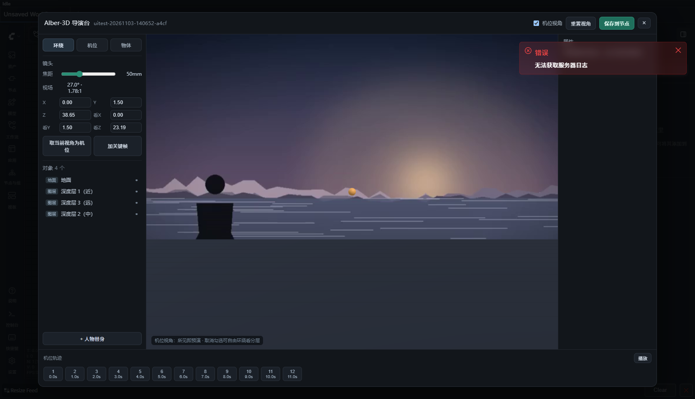
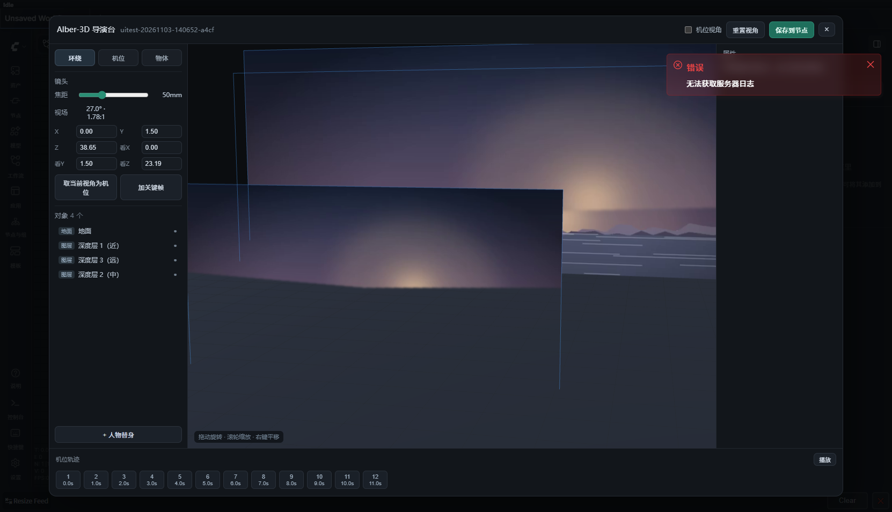

# ComfyUI-Alber-DirectorStage · Alber-3D 导演台

[](LICENSE)
[](https://github.com/comfyanonymous/ComfyUI)

把一段 MP4 逆向成一个**可以转、可以摆、可以改机位**的 3D 场景，再按你需要的新机位重新出预演，最后打包成
**MiniMax H3（ref2va）** 认识的 `<Picture N>` 参考图 + 运镜提示词。

一句话流程：

```
MP4 → 抽帧 + 单目深度 + 相机轨迹 → 2.5D 分层场景 → Alber-3D 导演台改机位/人物 → 预演关键帧 → H3 参考包
```

---

## 为什么不是"真 3D 重建"

| 方案 | 现实代价 |
|---|---|
| NeRF / 3DGS | 要几十张多视角图 + 训练，ComfyUI 里跑不动，也不适合"改机位重出" |
| 三角网格重建（COLMAP） | 单目视频勉强能跑，但几十秒素材要几分钟，且网格一破就没法用 |
| **2.5D 深度分层（本方案）** | 一帧深度切成 2~4 层贴图，相机一动就有真实视差；秒级完成，改机位立刻重渲 |

这套东西的定位是**预演（previs）**，不是资产重建：它保证透视、景别、人物位置、运镜方向对，
像素级还原交给 H3 去"脑补"。这也是为什么最终产物是参考图和提示词，而不是点云或网格。

---

## 安装

```bash
cd ComfyUI/custom_nodes
git clone https://github.com/jiyaxi2003-jzl/ComfyUI-Alber-DirectorStage.git
pip install -r ComfyUI-Alber-DirectorStage/requirements.txt
# 重启 ComfyUI
```

依赖：`numpy`、`opencv-python`（ComfyUI 一般已有）、`torch`（ComfyUI 自带）。
视频解码优先用 `av`（PyAV），没有就退回 OpenCV。**前端 three.js 已内置**，不联网也能用。

节点在菜单的 **「Alber-导演台」** 分类下：

| 节点 | 作用 |
|---|---|
| Alber-导演台 · 视频转3D | MP4 → 深度 + 相机轨迹 → 分层场景 + 主体替身 |
| Alber-导演台 · 场景编辑 | 交互节点，"打开 Alber-3D 导演台"改机位/人物，结果存进 `state` |
| Alber-导演台 · 预演渲染 | 沿轨迹出 预演图/深度/骨骼/线稿/蒙版 |
| Alber-导演台 · H3参考包 | 组装 `<Picture 1..4>` 参考图 + 提示词 + AddGuide 建议 |
| Alber-导演台 · 保存/载入场景 | `scene.json` 落盘与复用 |

**前端是怎么加载的**（改代码时会踩到）：ComfyUI 会把 `WEB_DIRECTORY`（这里是 `./web`）
下的 **所有 `.js` 递归扫描**并逐个 `import()`，所以 `web/js/director_stage.js` 会被自动
当成扩展执行，不需要额外配置；服务路径是 `/extensions/ComfyUI-Alber-DirectorStage/js/...`。
副作用是 `vendor/three.module.js` 也会在首屏被拉一次（本地读取，约 1.3MB），换来的是
`console.js` 里 `import()` 直接命中缓存。改完 JS 记得 **Ctrl+F5** 硬刷新。

---

## 快速开始

1. 拖入 **视频转3D**，填 MP4 绝对路径（或把文件放到 `ComfyUI/input` 只填文件名）
   - 首次建议：`max_frames=16`、`layers=3`、`lens_mm=35`、`depth_backend=auto`
2. 排队运行一次，节点会输出：场景、参考帧、深度图、报告
3. 接上 **场景编辑**，点 **「打开 Alber-3D 导演台」**（必须先把第 1 步跑过一次，前端要从后端取场景）
4. 在导演台里改机位、加人物、调焦距 → **保存到节点**
5. 接 **预演渲染**（`shot_count` = 你要几个机位）→ 再接 **H3参考包**
6. H3参考包输出 4 路图片，分别接 `MiniMaxH3ReferenceToVideo` 的 `ref_image_0..3`；
   `提示词` 接到正向提示词；`AddGuide建议` 告诉你其余机位怎么挂时间轴

> H3 的参考图是靠提示词里的 `<Picture 1>` 占位对应的，**图和提示词必须成套**——
> 所以本插件的提示词是自动生成的，别只接图不接词。

---

## 导演台操作

打开时默认停在 **机位视角**——你看到的就"重建出来的那一帧"，和参考视频的第一帧几乎一样。
把顶部「机位视角」的勾去掉，相机退到斜后方，能看到 **一摞立起来的贴图板**（带蓝色描边），
这时候拖动旋转、改焦距，就能直观判断"挪多少不会穿帮"。

| 操作 | 说明 |
|---|---|
| 顶部 **机位视角** | 勾上=所见即预演；取消=自由环绕看分层 |
| 拖动 / 滚轮 / 右键 | 自由视角下旋转、缩放、平移，不影响机位 |
| 左侧 **焦距** | 12–135mm，实时改 FOV |
| **取当前视角为机位** | 把当前观察视角变成这个镜头（最常用） |
| 模式 **机位** | 拖橙色球改"看向点"；镜头位置用左侧数值微调 |
| 模式 **物体** | 拖轴移动；`W/E/R` 切换 移动/旋转/缩放 |
| 左侧 **对象列表** | 点眼睛隐藏/显示某一层，点名字选中 |
| **+ 人物替身** | 在镜头前放一个可摆姿势的替身（站立/行走/奔跑/下蹲/坐姿/举手/指向） |
| 底部 **机位轨迹** | 攒关键帧、回放，`shot_count` 按帧数自动取机位 |
| **保存到节点** | 把状态写进 `state` widget；之后排队运行即为新机位 |

替身只用于构图、蒙版和 OpenPose 骨骼，不会被渲染成人。

| 机位视角（重建出来的那一帧） | 自由环绕（三层板子的真实纵深） |
|---|---|
|  |  |

---

## 深度后端怎么选

`depth_backend` 四档，质量与依赖成反比：

| 值 | 做法 | 适用 |
|---|---|---|
| `input` | 用你接进来的 `depth_in` 图批次 | **最准**：已有 DepthAnything/DepthPro 节点就接进来 |
| `model` | transformers 加载 `Depth-Anything-V2`（本地 `models/depth_anything` 优先，否则联网下载） | 有网、想要开箱可用 |
| `flow` | 特征点对齐消掉全局运动后的残余光流 → 视差 → 深度；**不需要下载任何模型** | 离线环境，横移/推拉镜头效果最好 |
| `ground` | 地平线假设的几何近似 | 纯兜底，只保证流程能跑通 |

`auto` 的顺序是 `model → flow → ground`。报告里会写明实际用了哪个，务必看一眼。

---

## 参数速查

**视频转3D**

| 参数 | 说明 |
|---|---|
| `max_frames` | 抽多少帧做分析（16 左右够用；只影响轨迹长度和耗时） |
| `layers` | 深度分层数：1=单张背景板（无视差），3=近中远三层（推荐），4=更细 |
| `near` / `far` | 场景的"米"尺度：最近层和最远层距相机多远。决定视差幅度 |
| `ref_index` | 用第几帧当贴图来源；多镜头素材换这个值就能取别的镜头 |
| `lens_mm` | 假设的拍摄焦距，影响卡片世界尺寸与运镜尺度 |
| `add_subject` | 自动在最近景检测一个"像人"的连通域，生成替身 |

**H3参考包**

| 参数 | 说明 |
|---|---|
| `shot_count` | 1–4，出几路参考图（H3 最多 9 张，需要更多就复制节点） |
| `duration` | 0 = 按轨迹时长推导；否则写死秒数 |
| `style_note` / `subject_note` / `extra_note` | 追加到提示词的风格/主体/补充约束 |

---

## 接 H3 的两种姿势

**A. 参考图为主（推荐）**

```
预演渲染(shot_count=4) ──► H3参考包 ──► ref_image_0..3 + 提示词 ──► MiniMaxH3ReferenceToVideo
```

**B. 多机位钉时间轴**

```
首帧 → ref_image_0 锁人物；其余机位 → MiniMaxH3AddGuide @ frame_idx（见"AddGuide建议"输出）
```

H3 对"运镜描述"很敏感：本插件把相机轨迹自动判定成"推镜/横移/升降/环绕/固定"，
直接写进提示词的【机位与运镜】段，比手写"make it cinematic"有效得多。

---

## 已知局限（先说清楚，省得白折腾）

1. **单目深度没有绝对尺度**：`near/far` 是你给的世界尺度，运镜幅度是"看起来合理"，不是真实米数。
2. **卡片会在边缘穿帮**：相机大幅偏离原机位时，近层贴图边缘会露馅。横向移动控制在 3m 内、俯仰 15° 内比较安全。
3. **人物替身不参与成像**：它只出蒙版和骨骼。真要换人，走 H3 的参考图/参考视频。
4. **纯旋转镜头**没有视差，`flow` 后端会退化成近似，视差会明显不足。
5. **自动主体检测是启发式**：不理想时把 `add_subject` 关掉，在导演台里手动 +人物替身。
6. **无头模式（只跑 API、不开页面）拿不到导演台状态**：`state` 是前端写入的，API 调用请把 state 直接写进 workflow JSON。
7. **H3 参考图上限 9 张**，且参考素材总数不超过 12；多机位请拆成多段生成。

---

## 排错

| 现象 | 原因/处理 |
|---|---|
| 点"打开导演台"报"还没有场景" | 先运行一次上游「视频转3D」，前端要从后端缓存取场景 |
| 点按钮无反应、控制台 404 `/director3d/scene` | 插件没被正确加载，看 ComfyUI 启动日志；确认目录名就是 `ComfyUI-Alber-DirectorStage` |
| 报告写"几何近似" | 深度模型不可用且用了单帧，改 `depth_backend=flow`，或把深度图接 `depth_in` |
| 预演图是空的/全黑 | 卡片贴图路径失效：确认 `ComfyUI/output/director_stage/<id>/card_*.png` 存在；换过机器要重新跑一次 |
| 视差很假、像贴纸 | `layers` 调小到 2 或调大 `near/far` 的比值；或换 `input` 深度 |
| 改了机位但预演没变 | 没点「保存到节点」，或没重新排队 |
| 视频读不进来 | 编码不支持：先转 H.264 MP4；或 `pip install av` |
| 节点上看不到「打开 Alber-3D 导演台」按钮 | 前端缓存了旧 JS：`Ctrl+F5` 硬刷新；仍不行看浏览器 Console 有没有 `director_stage.js` 的报错 |
| 改了 JS 打开还是旧界面 | 静态文件带缓存，硬刷新或用无痕窗口 |
| 视口全黑但面板正常 | 显卡/远程桌面下 WebGL 起不来，换本机浏览器；`chrome://gpu` 看 WebGL 是否被禁 |

### 自检脚本（不点鼠标也能验证）

```bash
# 后端全链路：解码 → 深度 → 场景 → 渲染 → 存盘
python tests/smoke_pipeline.py path/to/video.mp4 --backend flow

# 前端：在真浏览器里建节点、点按钮、检查扩展是否注册（需要 ComfyUI 已启动）
python tests/ui_check.py   --base http://127.0.0.1:8188 --out shots
# 前端：真的打开导演台，读 WebGL 像素，确认视口渲染出了东西
python tests/ui_console.py --base http://127.0.0.1:8188 --out shots
```

`ui_check.py` / `ui_console.py` 自带一个极简 CDP 客户端（`tests/cdp.py`，不依赖
selenium / playwright），直接驱动本机 Chrome。`ui_console.py` 需要先跑过一次
「视频转3D」，后端缓存里得有场景。

---

## 目录结构

```
ComfyUI-Alber-DirectorStage/
├── __init__.py              # 节点注册 + /director3d/scene 接口
├── dir_nodes.py             # 6 个节点
├── director3d/
│   ├── scene.py             # 场景数据结构与相机数学（前后端同一套语义）
│   ├── video_io.py          # 抽帧、镜头切换检测
│   ├── depth.py             # 4 种深度后端
│   ├── track.py             # ORB + 本质矩阵 + 深度定标的相机轨迹
│   ├── build.py             # 帧+深度+轨迹 → 分层卡片 / 地面 / 主体替身
│   ├── raster.py            # 纯 CPU 光栅化：预演/深度/法线/线稿/蒙版
│   ├── pose.py              # 18 点 COCO 骨骼与 OpenPose 绘制
│   ├── h3.py                # <Picture N> 提示词与机位表
│   └── tensor.py            # numpy ↔ ComfyUI IMAGE
├── web/
│   ├── js/director_stage.js # 前端扩展入口（挂按钮、取场景、写回 state）
│   ├── js/director/console.js  # 导演台控制台
│   ├── js/director/rig.js   # 替身与机位线框（与 pose.py 顶点表一致）
│   ├── js/vendor/           # three.js r170（已内置）
│   └── css/director.css
├── demo/                    # 本地演示：不需要 ComfyUI 也能把控制台跑起来
├── docs/                    # README 引用的截图
├── pyproject.toml           # 打包元数据（可直接发到 ComfyUI Registry）
└── tests/
    ├── smoke_pipeline.py    # 后端端到端冒烟
    ├── cdp.py               # 极简 Chrome DevTools 客户端（零依赖）
    ├── ui_check.py          # 前端：节点/按钮/接口
    ├── ui_console.py        # 前端：导演台视口是否真的渲染
    └── wf_video_to_scene.json  # 可直接 POST /prompt 的最小工作流
```

---

## 本地演示（不装 ComfyUI 也能看界面）

```bash
python demo/serve.py            # http://127.0.0.1:8899/demo/director.html
python tests/smoke_pipeline.py path/to/video.mp4 --backend flow
```

`demo/still.png` 是脚本合成的演示画面（`demo/make_demo.py` 可重新生成），
`demo/assets/*.png` 就是被切出来的深度层——和真实流程产出的东西一模一样。

---

## 致谢

前端交互范式参考了 [comfyui-3d-model-viewer](https://github.com/aesethtics/comfyui-3d-model-viewer)
（相机位置/看向点/焦段参数 + three.js 视口）与 ComfyUI 官方 `Load3D` 的做法；
深度思路来自 Depth-Anything 系列。本项目的差异在于：输入是视频、场景可编辑、产物面向 H3 参考生成。

---

## 许可

[MIT](LICENSE)。`web/js/vendor/` 下的 three.js r170 同样以 MIT 分发，版权归 Three.js Authors。

欢迎提 issue / PR。如果它帮你省了搭预演的时间，给颗 star 就够了。
